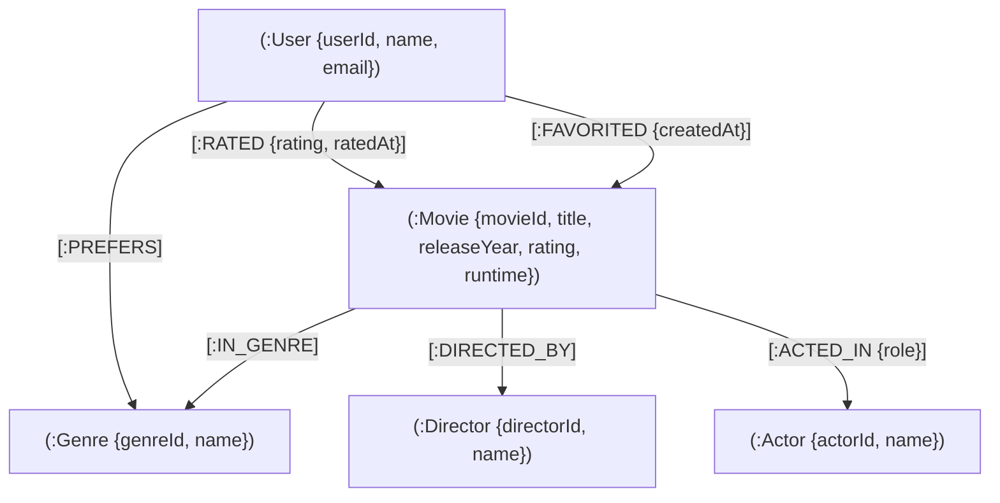

# 🎬 CineGraph — Graph-Powered Movie Recommendation Platform

> **Discover Movies Through Connections.**  
> CineGraph is a full-stack, graph-based movie exploration and recommendation platform powered by **Neo4j**, **Express**, and **React**. Rather than treating movies as isolated rows in a relational database, CineGraph models films, genres, directors, actors, and user interactions as a rich, connected knowledge graph.

---

## 🌟 Key Features

- **🧠 Multi-Strategy Recommendation Engine**
  - **Collaborative Filtering:** Identifies similar users through shared rating patterns and mutual favorites via graph traversals.
  - **Content-Based Filtering:** Traverses shared genres, subgenres, and thematic categories.
  - **Cast & Crew Connectivity:** Discovers films sharing common directors and actors with weighted node centrality.
  - **Hybrid Ensemble Scoring:** Normalizes and blends signals dynamically, providing transparent, evidence-based explanations for every recommendation.
  - **Evaluation Suite:** Built-in offline evaluation scripts measuring Precision@K, Recall@K, and NDCG@K.

- **🕸️ Interactive Graph Explorer**
  - Built with **Cytoscape.js** for real-time, interactive graph visualization.
  - Explore multi-hop relationships between `Movie`, `Genre`, `Director`, `Actor`, and `User` nodes.
  - Dynamic physics layouts, node filtering, focus modes, and interactive property inspection drawers.

- **📊 Analytics & Insights Dashboard**
  - Real-time graph analytics rendered with **Recharts**.
  - Visualizes rating distributions, top-connected talent, popular genres, and user activity trends.

- **🎯 Rich Movie Catalog & Watchlist**
  - Instant debounced search and multi-criteria filtering (genre, year, rating).
  - 1-to-5 star rating system and one-click favorite/watchlist management.
  - High-res poster integration with automated **TMDB** synchronization.

- **🛡️ Robust Security & Architecture**
  - **JWT Authentication** stored in secure, `HttpOnly`, `SameSite` cookies.
  - Multi-tier rate limiting for auth and API routes.
  - **CSRF protection**, **Helmet** security headers, input validation via `express-validator`, and sanitized Cypher queries.

---

## 🏗️ Graph Data Model

CineGraph models the cinematic domain as a labeled property graph:



---

## 🛠️ Technology Stack

| Layer | Technologies |
| :--- | :--- |
| **Database** | Neo4j Graph Database (v5+), Cypher Query Language, Neo4j JavaScript Driver |
| **Backend** | Node.js (ES Modules), Express.js, JWT, bcryptjs, Helmet, Express-Rate-Limit |
| **Frontend** | React 18, Vite, Cytoscape.js, Recharts, Tailwind CSS, Lucide React, Axios |
| **Testing** | Vitest, Supertest (Unit & Integration tests) |
| **Dev Tools** | Concurrently, Nodemon, PostCSS, ESLint |

---

## 📂 Project Structure

```text
CineGraph/
├── backend/
│   ├── src/
│   │   ├── config/          # Neo4j connection, recommendation weights & env loader
│   │   ├── controllers/     # Route handlers (auth, movies, recommendations, graph, analytics)
│   │   ├── data/            # Seed data (curated movies, genres, demo users)
│   │   ├── middleware/      # Auth verification, rate limiters, CSRF, error handling
│   │   ├── queries/         # Pure Cypher query definitions
│   │   ├── repositories/    # Neo4j database interaction layer
│   │   ├── routes/          # Express route declarations
│   │   ├── scripts/         # Schema constraints, DB seeding, evaluation & TMDB sync
│   │   ├── services/        # Scoring algorithms, recommendation logic & explanations
│   │   ├── utils/           # Neo4j type transforms, response helpers & ApiError
│   │   ├── validators/      # Express-validator validation schemas
│   │   ├── app.js           # Express application configuration
│   │   └── server.js        # Server bootstrap and lifecycle management
│   ├── tests/
│   │   ├── integration/     # Neo4j database & API integration tests
│   │   └── unit/            # Scoring, explanations & validator unit tests
│   └── package.json
│
├── frontend/
│   ├── src/
│   │   ├── components/
│   │   │   ├── common/      # Spinners, skeletons, modals, alerts
│   │   │   ├── graph/       # Cytoscape graph explorer, legends, node details panel
│   │   │   ├── layout/      # Navbar, footer, layout wrapper
│   │   │   ├── movies/      # Movie cards, carousels, filters, star rating
│   │   │   └── recommendations/ # Recommendation cards, score breakdown, explanations
│   │   ├── context/         # AuthContext and ToastContext
│   │   ├── hooks/           # useAsync, useDebounce
│   │   ├── pages/           # Home, Explore, MovieDetails, Recommendations, Graph, Analytics, Profile
│   │   ├── services/        # Axios API client
│   │   └── styles/          # Tailwind CSS & global styling
│   └── package.json
│
├── package.json             # Root workspace script runner (concurrently)
└── README.md
```

---

## 🚀 Quick Start Guide

### 1. Prerequisites
- **Node.js**: `v18.18` or higher
- **Neo4j**: Local Neo4j Desktop / Docker container OR a free cloud instance on [Neo4j AuraDB](https://neo4j.com/cloud/platform/aura-graph-database/)

### 2. Clone Repository
```bash
git clone https://github.com/ShreeyaKalebere/CineGraph-.git
cd CineGraph-
```

### 3. Install Dependencies
Install dependencies for both backend and frontend in one step:
```bash
npm run install:all
```
*(Or run `npm install` inside both `backend` and `frontend` folders)*

### 4. Configure Environment Variables

**Backend (`backend/.env`):**
Create `backend/.env` (copy from `backend/.env.example`):
```ini
NODE_ENV=development
PORT=5000
CLIENT_URL=http://localhost:5173

# Neo4j Connection
NEO4J_URI=neo4j://localhost:7687
NEO4J_USERNAME=neo4j
NEO4J_PASSWORD=your-neo4j-password
NEO4J_DATABASE=neo4j

# Authentication Secret (minimum 32 characters)
JWT_SECRET=super-secret-random-key-at-least-32-chars-long
JWT_EXPIRES_IN=7d
COOKIE_SAMESITE=lax

# Optional: TMDB Read Access Token (for syncing real movie posters)
TMDB_READ_ACCESS_TOKEN=
```

**Frontend (`frontend/.env`):**
Create `frontend/.env` (copy from `frontend/.env.example`):
```ini
VITE_API_URL=/api
```

### 5. Setup Database Constraints & Seed Sample Data
Ensure your Neo4j instance is running, then populate the graph with curated movies, actors, directors, genres, and sample users:
```bash
npm run seed
```
> **Tip:** To wipe the database and re-seed from scratch, run `npm run seed:reset --prefix backend`.

### 6. Run the Application
Launch both backend and frontend concurrently:
```bash
npm run dev
```
- **Web App**: [http://localhost:5173](http://localhost:5173)
- **API Server**: [http://localhost:5000](http://localhost:5000)
- **Health Check**: [http://localhost:5000/api/health](http://localhost:5000/api/health)

---

## 👤 Demo Accounts

The seed script creates pre-configured personas with distinct movie preferences to immediately test recommendation logic:

| Name | Email | Password | Persona |
| :--- | :--- | :--- | :--- |
| **Aarav Sharma** | `aarav@cinegraph.demo` | `Demo@1234` | Sci-Fi & Christopher Nolan enthusiast |
| **Priya Nair** | `priya@cinegraph.demo` | `Demo@1234` | Space epics & Denis Villeneuve fan |
| **Vikram Roy** | `vikram@cinegraph.demo` | `Demo@1234` | Psychological thrillers & Neo-noir |
| **Ananya Patel**| `ananya@cinegraph.demo` | `Demo@1234` | Modern Classics & Drama |

---

## 📡 API Overview

| Method | Endpoint | Description | Auth Required |
| :--- | :--- | :--- | :---: |
| `POST` | `/api/auth/register` | Register new user | No |
| `POST` | `/api/auth/login` | Login and receive secure session cookie | No |
| `POST` | `/api/auth/logout` | Clear session cookie | Yes |
| `GET` | `/api/auth/me` | Fetch authenticated user profile | Yes |
| `GET` | `/api/movies` | Browse movies with pagination, search & filters | No |
| `GET` | `/api/movies/:id` | Get movie details, cast, director, and average rating | No |
| `POST` | `/api/movies/:id/rate` | Rate a movie (1–5) | Yes |
| `POST` | `/api/movies/:id/favorite` | Toggle movie favorite status | Yes |
| `GET` | `/api/recommendations` | Get personalized hybrid recommendations | Yes |
| `GET` | `/api/graph/explore` | Fetch graph nodes & edges for interactive explorer | No |
| `GET` | `/api/analytics/overview` | Fetch graph-wide analytics & stats | No |

---

## 🧪 Running Tests

CineGraph includes comprehensive unit and integration test suites:

```bash
# Run unit tests (scoring logic, validation, transformers)
npm run test

# Run integration tests (against active Neo4j test database)
npm run test:integration

# Run all test suites
npm run test:all --prefix backend
```

---

## 🤝 Contributing

Contributions are welcome! If you'd like to improve CineGraph:
1. Fork the repository
2. Create your feature branch (`git checkout -b feature/AmazingFeature`)
3. Commit your changes (`git commit -m 'Add some AmazingFeature'`)
4. Push to the branch (`git push origin feature/AmazingFeature`)
5. Open a Pull Request

---

## 📄 License

This project is licensed under the MIT License — see the LICENSE file for details.
